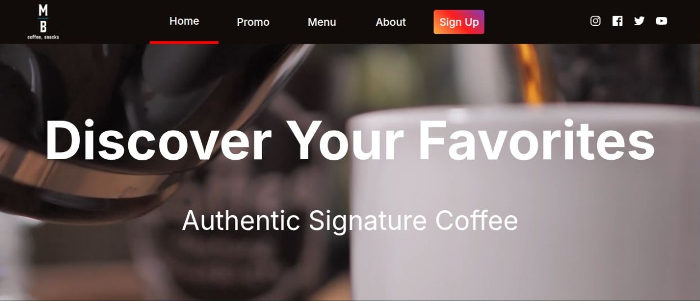
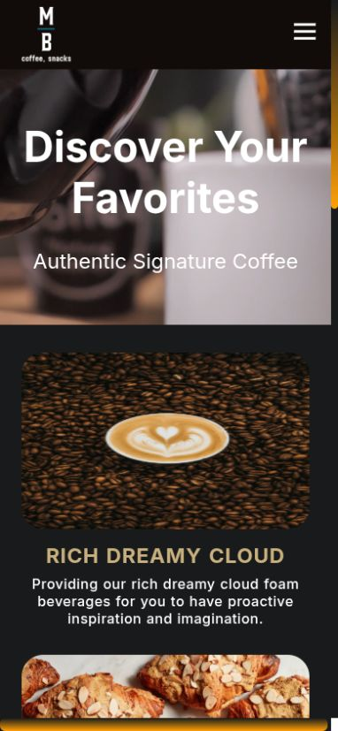

## About this project
A group-based web design project in college: a responsive coffee shop website with
rotating promotions and coffee and snack menus.

<table>
  <tr>
    <td valign="top">
      
    </td>
    <td valign="top">
      
    </td>
  </tr>
</table>

## Local server startup
Static HTML, CSS, and JavaScript; no build step or runtime dependencies.

Serve the repository with `python3 -m http.server 8000`, then open
`http://localhost:8000`.

Run the interaction regression tests with Node.js 18 or newer:

```sh
node --test tests/app.test.cjs
```

Tests cover navigation state, Escape handling, scroll highlighting, category
switching, and independent slideshow timing and wraparound using a simulated DOM.
Check desktop and mobile layouts in a browser after CSS changes.
